# EMS-ESP Manager für Home Assistant

[](https://hacs.xyz)
[](https://github.com/Sascha883/EMS-ESP-Manager/releases)
[](https://www.home-assistant.io)
[](LICENSE)

Custom-Integration, mit der du ein [EMS-ESP](https://github.com/emsesp/EMS-ESP32)-Gateway (z. B. von BBQKees) komplett aus Home Assistant bedienst – ohne die EMS-ESP-Weboberfläche. Dazu gibt es ein **Bosch-HMI-800-Panel**, das sich wie das Original-Display der Wärmepumpe bedienen lässt.

Entwickelt und getestet an einer **Bosch Compress CS5800i mit UI 800**.

> **Hinweis:** Kein offizielles Projekt von EMS-ESP, BBQKees oder Bosch. Nutzung auf eigene Gefahr – Änderungen an Wärmepumpen-Parametern nur mit Fachkenntnis.

<p align="center">
  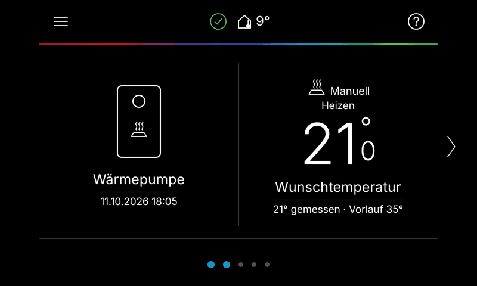
</p>

---

## Inhalt

- [Funktionen](#funktionen)
- [Screenshots](#screenshots)
- [Voraussetzungen](#voraussetzungen)
- [Installation](#installation)
- [Einrichtung](#einrichtung)
- [Entitäts-Namen und EMS-ESP-Versionen](#entitäts-namen-und-ems-esp-versionen)
- [Hinweise aus der Praxis](#hinweise-aus-der-praxis-bosch-cs5800i--ui-800)
- [Fehler melden](#fehler-melden)
- [Lizenz](#lizenz)

---

## Funktionen

### Bosch HMI 800 Panel
- Bedienoberfläche im Stil des Bosch UI 800 – als Eintrag in der Seitenleiste oder als **Kiosk-Adresse** für ein Wand-Tablet.
- Heizen und Warmwasser mit Aus / Auto / Manuell, Wunschtemperatur per Rolle, Extra-Warmwasser.
- **Schaltzeiten** für Heizkreis 1 und Warmwasser lesen und schreiben (Telegramme `0x02C3` und `0x02FF` – kennt EMS-ESP selbst nicht).
- **Energie Monitoring** mit Tageswerten („Heute“) und Gesamtwerten, Anteil Umweltwärme und Arbeitszahl.
- Systemübersicht, Heizkurve, Sommer-/Winterumschaltung, Servicemenü mit Diagnose.
- **Störung und Wartungsmeldung zurücksetzen** direkt im Panel.
- **Automatische Entitäts-Zuordnung** – funktioniert mit allen EMS-ESP-Entity-ID-Formaten (Kurz- und Langnamen, mit Präfix, umbenannt).

### Manager-Dashboard „EMS-ESP“
- **System & Firmware** – Status, Bus, WLAN, Laufzeit; Firmware-Updates und Wechsel auf ältere stabile Versionen direkt aus HA.
- **Einstellungen und Messwerte** aller EMS-Geräte, automatisch erzeugt.
- **Zuordnung** der Panel-Felder, gruppiert nach Heizung, Warmwasser, Wärmepumpe, Energie.
- **Bus-Log** – Live-Mitschnitt der EMS-Telegramme, Download als Textdatei, Log-Level und Tx-Modus einstellbar.
- **MQTT** – alle MQTT-Einstellungen des EMS-ESP (Broker, Discovery, Entity-ID-Format, Sendeintervalle) mit Statusanzeige.
- **Web-Oberfläche** des EMS-ESP eingebettet.

📄 Ausführliche Anleitung: [Installationsanleitung (PDF)](EMS-ESP-Manager_Installationsanleitung_v1.10.2.pdf)

---

## Screenshots

### Bosch HMI 800 Panel

| Startseite | Heizen |
|:---:|:---:|
| 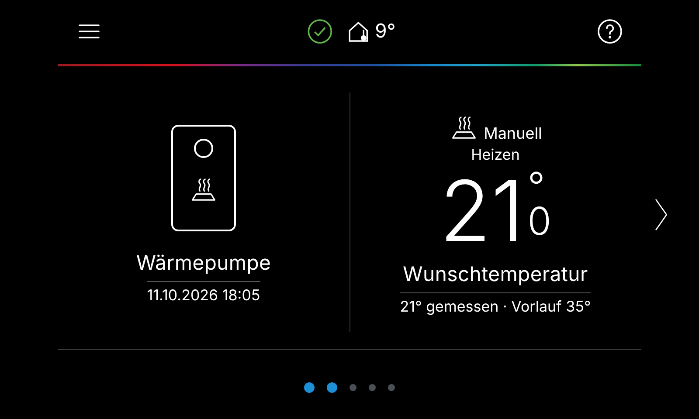 | 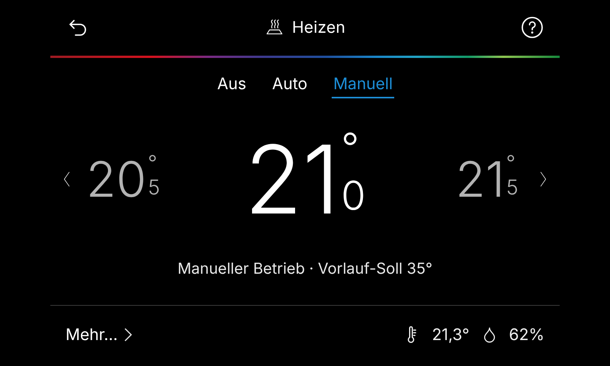 |
| **Warmwasser** | **Systemübersicht** |
| 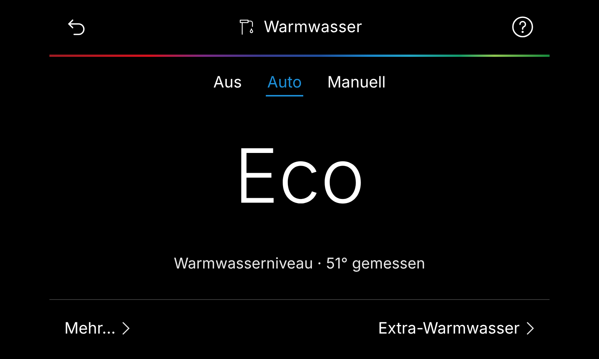 | 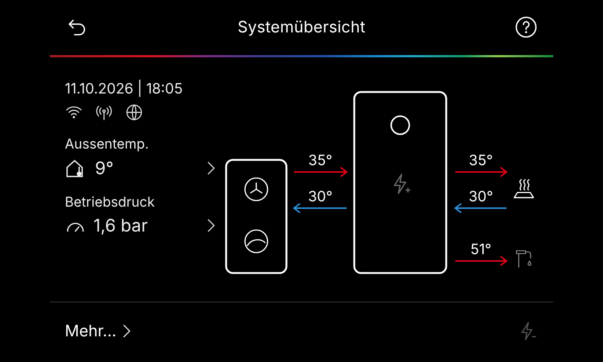 |
| **Energie Monitoring** | **Schaltzeiten Warmwasser** |
| 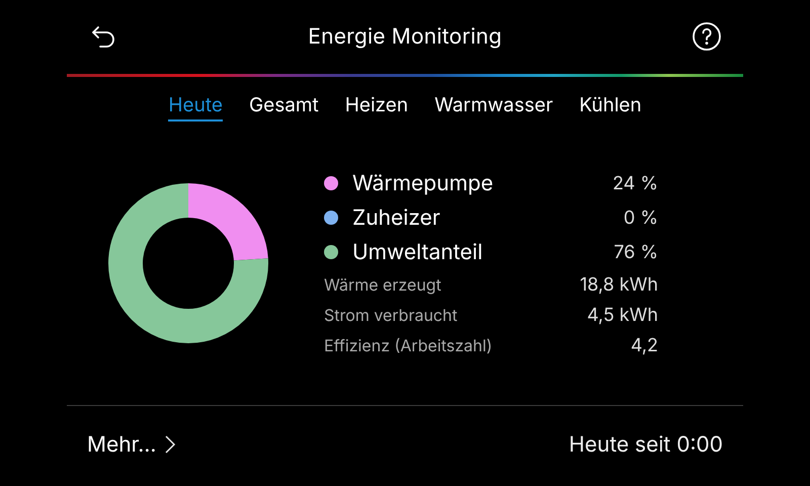 | 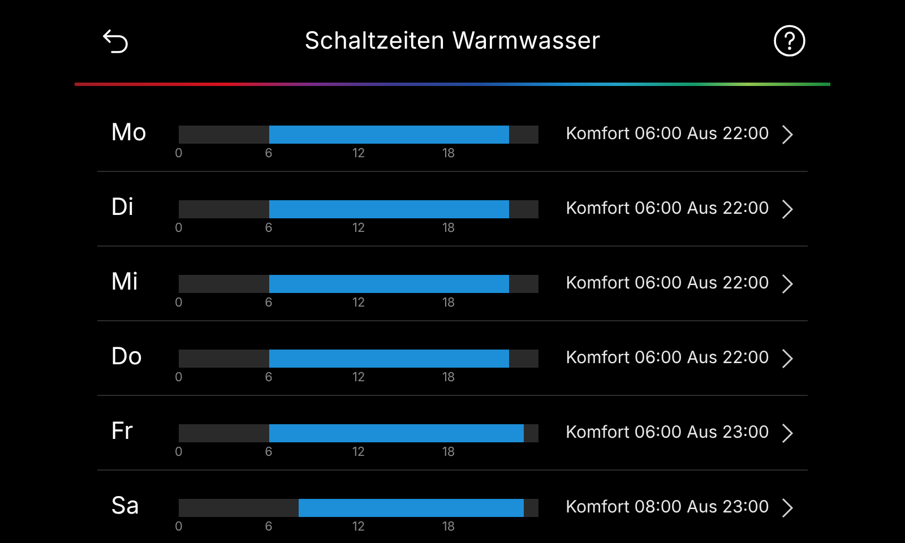 |
| **Heizkurve** | **Entitäten-Zuordnung** |
| 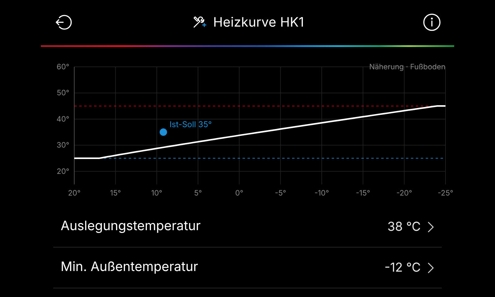 | 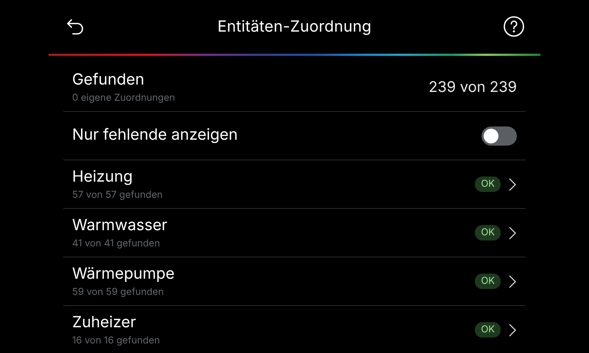 |

### Manager-Dashboard in Home Assistant

| System & Firmware | Bus-Log |
|:---:|:---:|
| 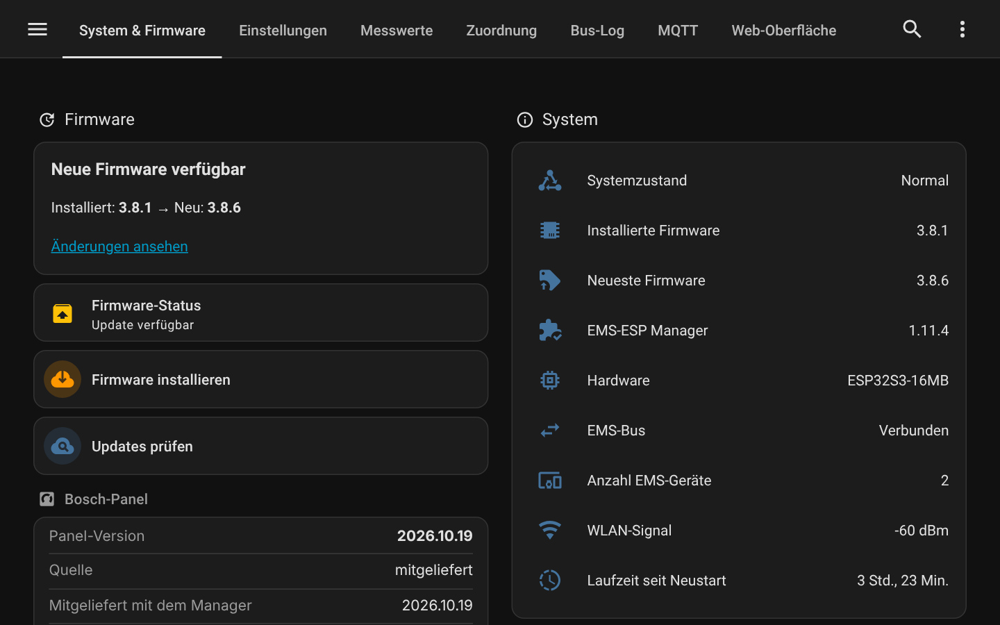 | 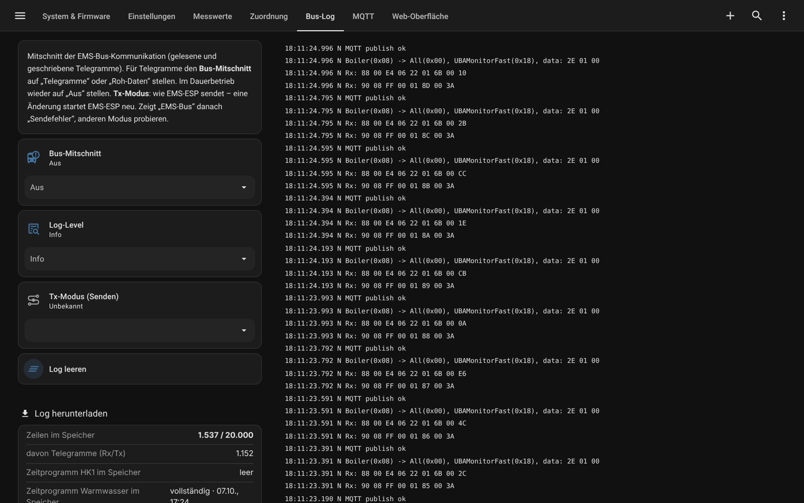 |
| **MQTT-Einstellungen** | **Servicemenü (Panel)** |
| 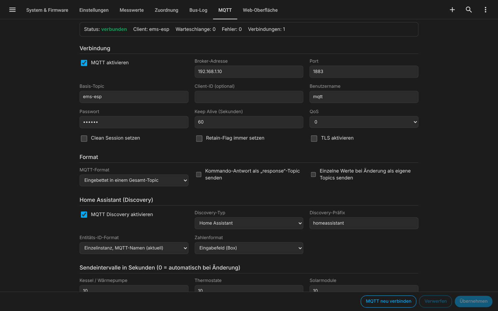 | 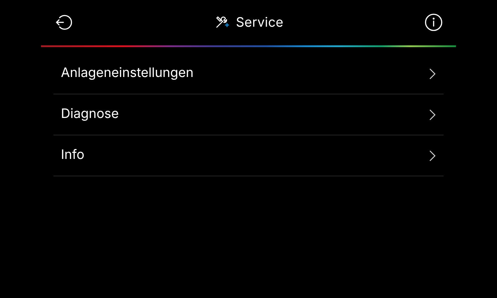 |

<sub>Screenshots mit Demo-Daten.</sub>

---

## Voraussetzungen

| | |
|---|---|
| **Home Assistant** | 2025.2 oder neuer |
| **EMS-ESP** | 3.7 oder neuer (getestet mit 3.8.6), Zugang mit Admin-Benutzer |
| **MQTT** | MQTT-Integration in Home Assistant, EMS-ESP mit aktivierter HA-Discovery |
| **Verlauf** | Recorder aktiv (Standard) – für die Tageswerte im Energie Monitoring |

---

## Installation

### Über HACS (empfohlen)

1. HACS → ⋮ → **Benutzerdefinierte Repositories** → `https://github.com/Sascha883/EMS-ESP-Manager`, Typ **Integration**.
2. „EMS-ESP Manager“ installieren.
3. Home Assistant neu starten.

### Manuell

1. Die ZIP-Datei aus den [Releases](https://github.com/Sascha883/EMS-ESP-Manager/releases) herunterladen und entpacken.
2. Den Ordner `ems_esp_manager` nach `config/custom_components/` kopieren.
3. Home Assistant neu starten.

### Update

Über HACS aktualisieren (oder den Ordner ersetzen), Home Assistant neu starten und das Panel einmal neu laden (Strg+F5). Zuordnung, Heizkreis-Namen, Kiosk-Schlüssel und gespeicherte Schaltzeiten bleiben erhalten.

---

## Einrichtung

1. **Einstellungen → Geräte & Dienste → Integration hinzufügen → „EMS-ESP Manager“**. Das EMS-ESP wird per Zeroconf meist automatisch gefunden.
2. **Adresse** des EMS-ESP (IP oder `ems-esp.local`), **Benutzer** und **Passwort** eines EMS-ESP-Admins eingeben.
3. Unter **Konfigurieren** einstellen:
   - Seitenleisten-Einträge für das Dashboard und das Panel (für alle oder nur Admins).
   - Token für den **Kiosk-Zugriff** auf das Panel (z. B. Wand-Tablet ohne Anmeldung).
   - **Fachbetrieb** (Name, Adresse, Telefon) für die Info-Seite des Panels.

Danach erscheinen in der Seitenleiste **„EMS-ESP“** (Dashboard) und **„Bosch HMI 800“** (Panel).

---

## Entitäts-Namen und EMS-ESP-Versionen

Das Panel findet die passenden Entitäten automatisch – egal, welches **Entity-ID-Format** im EMS-ESP eingestellt ist:

| Format im EMS-ESP | Beispiel |
|---|---|
| Einzelinstanz, MQTT-Namen (Standard) | `sensor.thermostat_hc1_summermode` |
| Mehrfachinstanzen | `sensor.ems_esp_thermostat_hc1_summermode` |
| Langnamen (v3.4) | `sensor.thermostat_hc1_summer_mode` |
| v3.5 / 3.6-kompatibel (Warmwasser) | `sensor.boiler_wwcurtemp` |
| In HA umbenannt / nach Gerät benannt | `sensor.warmepumpe_summer_mode` |

Beim **UI 800 / HMI 800** liefert EMS-ESP 3.8.x einige Werte (Sommer-/Winterumschaltung, Heizbetrieb bis, Kühlstart, Verzögerungen) nur für die ganze Anlage statt pro Heizkreis – das Panel nutzt dann automatisch diese Werte. Auch die geänderte Betriebsart aus EMS-ESP 3.9-dev (Sommer/Auto/Winter) wird unterstützt.

Eigene Zuordnungen im Reiter **„Zuordnung“** haben immer Vorrang.

---

## Hinweise aus der Praxis (Bosch CS5800i / UI 800)

- **Tx-Modus nicht auf „Auto“ lassen.** Ab EMS-ESP 3.8.2 ist „Auto“ Standard; bei der CS5800i wählte die Automatik nach einem Neustart teils falsch (Bus-Status „Sendefehler“, Regler nicht erkannt). Fest **EMS+** (oder EMS) funktioniert.
- **Warmwasser Start-/Stopptemperatur:** Die Wärmepumpe erzwingt Stopp ≥ Start + 6 K (Komfort) bzw. + 7 K (Eco, Eco+) und hebt zu kleine Werte ohne Meldung an. Beim Absenken zuerst die Start-, dann die Stopptemperatur ändern.
- Die „Temp.-diff. für Beladung“ (`comfdiff` / `ecodiff` / `ecoplusdiff`) ist das Ladedelta (Vorlauf über Warmwassertemperatur), nicht der Abstand zwischen Start und Stopp.
- **Schaltzeiten:** Der Regler beantwortet Leseanfragen nur in seinen 24-Byte-Blöcken; geschrieben wird immer das komplette Wochenprogramm – genau wie es das Display macht.

---

## Fehler melden

Bitte ein [Issue](https://github.com/Sascha883/EMS-ESP-Manager/issues) anlegen mit:

- Version des EMS-ESP Managers und von EMS-ESP.
- Regler / Wärmepumpe (z. B. UI 800, CS5800i).
- Screenshot der betroffenen Seite.
- Bei fehlenden Werten: Ausgabe dieser Vorlage (Entwicklerwerkzeuge → Template):
  ```
  {{ integration_entities('mqtt') | select('search', 'thermostat|boiler') | list }}
  ```
- Bei Bus-Themen: Telegramm-Log aus dem Reiter **Bus-Log** (Download).

---

## Lizenz

**PolyForm Noncommercial License 1.0.0** – siehe [LICENSE](LICENSE).

- ✅ Erlaubt: private Nutzung, Ausprobieren, Anpassen für den Eigenbedarf, gemeinnützige Organisationen, Bildung, Forschung.
- ❌ Nicht erlaubt: kommerzielle Nutzung jeder Art – z. B. Einsatz bei Kunden durch Fachbetriebe oder Dienstleister, Verkauf oder Einbau in kommerzielle Produkte.

Kommerzielle Nutzung nur mit gesonderter Lizenz – Anfrage über [haustechnik-matheis.de](https://haustechnik-matheis.de).

Die Nutzung erfolgt auf eigene Gefahr und ohne jegliche Gewährleistung oder Haftung. Versionen, die vor dem Lizenzwechsel unter MIT veröffentlicht wurden, bleiben unter MIT.

---

<p align="center">
  <br>
  <b>Sascha Matheis Haustechnik</b> · Espenau · Kassel · Nordhessen<br>
  <a href="https://haustechnik-matheis.de">haustechnik-matheis.de</a> · Instagram <a href="https://www.instagram.com/haustechnik_matheis">@haustechnik_matheis</a>
</p>
