<p align="center">
  
</p>

# EMS-ESP Manager für Home Assistant

[](https://hacs.xyz)
[](https://github.com/Sascha883/EMS-ESP-Manager/releases)
[](https://www.home-assistant.io)
[](LICENSE)

Custom-Integration, mit der du ein [EMS-ESP](https://github.com/emsesp/EMS-ESP32)-Gateway (z. B. von BBQKees) komplett aus Home Assistant bedienst – ohne die EMS-ESP-Weboberfläche. Dazu gibt es ein **eigenes Bedien-Panel** (Touch-Oberfläche für Seitenleiste und Wand-Tablet) und **EMS-Regelfunktionen** wie die Warmwasseroptimierung mit PV-Strom.

Entwickelt und getestet an einer Wärmepumpe Bosch Compress CS5800i mit Bedieneinheit UI 800 (Angabe zur Kompatibilität).

**Neu ab v1.13: Samsung EHS.** Bei der Einrichtung wählst du den Hersteller – **Bosch / Buderus (EMS-ESP)** oder **Samsung EHS (EHS Sentinel)**. Beide nutzen dasselbe Panel mit derselben Menüführung. Wer beides hat, fügt die Integration zweimal hinzu.

> [!NOTE]
> Kein offizielles Projekt von EMS-ESP, BBQKees, Bosch, Buderus, Samsung, Brötje oder anderen Herstellern; es besteht keine Verbindung zu diesen Unternehmen. Hersteller- und Produktnamen sind Marken ihrer Inhaber und werden nur verwendet, um anzugeben, mit welchen Geräten die Integration zusammenarbeitet. Nutzung auf eigene Gefahr – Änderungen an Wärmepumpen-Parametern nur mit Fachkenntnis.

<p align="center">
  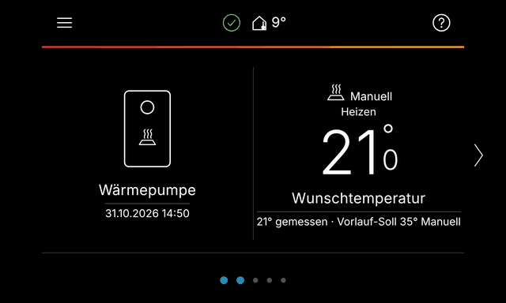
</p>

---

## Inhalt

- [Funktionen](#funktionen)
  - [Samsung EHS](#samsung-ehs)
- [Screenshots](#screenshots)
- [Voraussetzungen](#voraussetzungen)
- [Installation](#installation)
- [Einrichtung](#einrichtung)
  - [Zugriff von außen (Wand-Tablet / Kiosk)](#zugriff-von-außen-wand-tablet--kiosk)
- [Entitäts-Namen und EMS-ESP-Versionen](#entitäts-namen-und-ems-esp-versionen)
- [Hinweise aus der Praxis](#hinweise-aus-der-praxis-bosch-cs5800i--ui-800)
- [Fehler melden](#fehler-melden)
- [Lizenz](#lizenz)

---

## Funktionen

### Panel
- Eigene Bedienoberfläche – als Eintrag in der Seitenleiste oder als **Kiosk-Adresse** für ein Wand-Tablet.
- **Heizen** mit Aus / Auto / Manuell, Wunschtemperatur per Rolle, Heizkurve mit Soll- und Ist-Linie, Vorlauf-Soll und aktuelles Niveau auf der Heizkreis-Kachel.
- **Warmwasser** mit Betriebsart, Extra-Warmwasser und **Verlauf der Warmwassertemperatur** (Soll/Ist, heute).
- **Programmzeiten** für Heizkreis 1 und Warmwasser lesen und schreiben (Telegramme `0x02C3` und `0x02FF` – kennt EMS-ESP selbst nicht).
- **Energie Monitoring** mit Tageswerten („Heute“) und Gesamtwerten, Anteil Umweltwärme und Arbeitszahl.
- Systemübersicht, Sommer-/Winterumschaltung, Kühlfunktionen ein-/ausblendbar.
- **Servicemenü** mit Diagnose und **Übersicht Kältekreislauf** (Temperaturen, Drücke, Kompressor, Ventilator, Expansionsventile – umschaltbar auf Bosch-Bezeichnungen).
- **Geräte am EMS-Bus** mit Softwarestand, Bus-ID und Produkt-ID (Service → Info).
- **Störung und Wartungsmeldung zurücksetzen** direkt im Panel.
- **Automatische Entitäts-Zuordnung** – funktioniert mit allen EMS-ESP-Entity-ID-Formaten (Kurz- und Langnamen, mit Präfix, umbenannt), inklusive Prüfung Lesen/Schreiben. Werte, die in HA fehlen, lassen sich mit einem Klick anlegen.

### Samsung EHS
Für Samsung-EHS-Wärmepumpen (Mono/Split) mit RS485-Adapter und der HACS-Integration [EHS Sentinel](https://github.com/echoDaveD/EHS-Sentinel).
- **Gleiches Panel wie bei Bosch**, Farben nach dem Samsung-Bedienteil (hell, Samsung-Blau) – eigener Seitenleisten-Eintrag **„Samsung EHS“**.
- Startseite mit **Zone** (Verschiebung der Heizkurve, Ein/Aus) und **Warmwasser** (Eco/Standard/Power, Solltemperatur), Systemübersicht, Energie mit Arbeitszahl.
- **Extra-Warmwasser** über „Forced DHW“, Dauer aus FSV 3052.
- **Heizkurve** nach dem Samsung-Wassergesetz (FSV 2011/2012/2021/2022, Min/Max 1031/1032).
- **Servicemenü → Anlageneinstellungen:** alle wichtigen **FSV-Werte** (10xx Grenzwerte, 20xx Heizkurve, 30xx Warmwasser, 40xx Heizung & Zuheizer, 50xx PV/Smart Grid/Outing) sowie Betrieb (Flüstermodus, Zone 2, Leistungsbegrenzung).
- **Diagnose:** Monitorwerte (Hydraulik, Verdichter, Drücke, Abtauung), Fehlercodes, **Verbindung & Protokoll** von EHS Sentinel (Verbindungsstatus, Paketzähler, Neu verbinden, Protokoll mit Filter, Paket-Log).
- **Heizstab-Regelung** (novolto) wie bei Bosch unter **Zusatzfunktionen**. Die Warmwasseroptimierung gibt es nur für EMS-ESP.
- **Seite „EMS-EHS“** in der Seitenleiste (wie „EMS-ESP“ bei Bosch): Übersicht (EHS Sentinel, Wärmepumpe, Fachbetrieb, Versionen, Kiosk), **alle Einstellungen** (Betrieb, FSV 10xx–50xx) direkt bedienbar, Messwerte mit Suche und das Protokoll von EHS Sentinel.
- Bosch-Menüpunkte ohne Samsung-Gegenstück werden automatisch ausgeblendet.
- Ersetzt die separate Integration „Samsung EHS Panel“ – diese danach entfernen.

### EMS-Regelung
Regelfunktionen, die in Home Assistant laufen – auch wenn das Panel geschlossen ist.
- **Erweiterte Ansicht (Testmodus, ab v1.23):** Leistungsbegrenzung und Heizstab stehen unter EMS-Regelung → *Erweiterte Ansicht (Testmodus)*. Vor dem Öffnen erscheint ein Hinweis, dass diese Funktionen experimentell sind und aktiv in die Regelung eingreifen – Nutzung auf eigene Verantwortung.
- **Warmwasseroptimierung:** Ist viel Sonne zu erwarten, wird der Speicher einmal am Tag höher aufgeheizt (Standard 60 °C), damit die Wärmepumpe mit eigenem PV-Strom läuft.
  - Vorhersage über eine **PV-Prognose**-Entität (kWh, z. B. Forecast.Solar, Solcast) oder eine **Wetter**-Entität (Bewölkung).
  - Optional zusätzlich **PV-Überschuss** (W/kW).
  - Zeitfenster und Zieltemperatur einstellbar; danach werden Betriebsart und Stopptemperatur automatisch zurückgesetzt.
- **Leistungsbegrenzung (Dimmung, Bosch/Buderus-WP, Test):** Die Wärmepumpe wird über den EMS-Bus gedimmt – ohne Relais.
  - Weg A: Ein externer Eingang (am UI 800 auf Leistungsbegrenzung/EVU eingestellt, unbeschaltet) wird per Software umgeschaltet (EMS-ESP `hpinNopt`, Invertier-Bit).
  - Weg B: Leistungsgrenze direkt in W (EMS-ESP `hppowerlimit`), falls die Wärmepumpe sie beantwortet.
  - Manuell, über einen Auslöser (binary_sensor/switch/input_boolean) und mit automatischem Ende.
  - **Funktionstest** mit Protokoll (Werte, Rohtelegramme 0x486/0x484/0x4A7, Schreib- und Rücklesetest, Kompressorleistung), Anzeige im Panel, Kopieren/Herunterladen.
  - Die §14a-Dimmung durch den Netzbetreiber läuft weiterhin über die Steuerbox am Klemmeneingang.
- **Externe Eingänge 1–4 (Service → Externer Eingang):** Funktion jedes Eingangs direkt aus dem Panel einstellen – EVU-Sperren, Kompressor/Zuheizer/Heizen/Kühlen/Warmwasser sperren, PV (Smart Grid), Überhitzungsschutz, Druckwächter, Logik invertieren, Begrenzungswert (Eingang 1 und 4). Geschrieben über EMS-ESP `hpinNopt`, mit Rücklesen. Hinweis CS5800i: Sie nimmt über 0x486 nur „Logik invertieren“ an.
- **Funktion anlernen (Service → Externer Eingang):** Schneidet den EMS-Bus mit (Ausgangszustand, 30 s Ruhephase, Anlernfenster, Endzustand), während die Funktion am UI 800 geändert wird. Zeigt neue Schreibzugriffe des UI 800 und geänderte Bytes, bei 0x486 mit Zuordnung „Eingang n: Funktion“. Schreibt nichts in die Wärmepumpe.
- **Heizstab (novolto P2300/P3000):** Anbindung über die lokale MQTT-API des Heizstabs (Broker von Home Assistant).
  - Betriebsarten **PV-Überschuss**, **feste Leistung** oder **Aus**.
  - PV-Überschuss: Leistung = Überschuss + aktuelle Heizstab-Leistung − Reserve, in 50-W-Schritten, mit Mindestleistung und Abschaltverzögerung.
  - Optional **Freigabe-Signal** (binary_sensor/switch/input_boolean) und **Akku-Mindestladestand**.
  - Maximaltemperatur und Hysterese werden in den Heizstab geschrieben; er regelt die Temperatur selbst.
  - Sicherheit: fehlender oder veralteter Überschusswert, Ausschalten der Regelung und Beenden von Home Assistant schalten den Heizstab aus.
  - Einrichtung im Heizstab (Hotspot „novolto-…“ → `http://192.168.2.1/expert`): `mqtt.broker_uri = mqtt://<IP von HA>:1883`, Benutzer/Passwort für Mosquitto, Neustart. Doku: https://docs.novolto.de/
  - **Als eigenes Gerät (ab v1.13.1):** *Gerät hinzufügen → Heizstab (novolto)* sucht den Heizstab am MQTT-Broker (er hängt per WLAN/LAN am Netz). Sobald er sich am Broker meldet, schlägt Home Assistant ihn auch automatisch unter „Entdeckt“ vor. Danach gibt es den Seitenleisten-Eintrag **„Heizstab“** – auch ohne Wärmepumpe.

- **ESP-Bus-Adapter (ab v1.14) – Siemens-Regler am BSB/LPB:** Brötje, Elco, Baxi, Atlantic, ATAG, Weishaupt, CTC und weitere Hersteller mit Siemens-Albatros-Reglern (LMS, LMU, RVS, RVA …). Im Panel unter **EMS-Regelung → ESP-Bus-Adapter**, als eigenes Gerät unter *Gerät hinzufügen → ESP-Bus-Adapter*.
  - **Adapter suchen:** ESPHome-Adapter (BSB-Atom), BSB-LAN aus der HA-Integration „BSB-LAN“ und auf Wunsch jedes BSB-LAN im Heimnetz. Ein gefundener Adapter erscheint automatisch unter „Entdeckt“.
  - **Regler-Erkennung:** 6224 Geräte-Identifikation, 6225 Gerätefamilie, 6226 Gerätevariante, Zuordnung der Baureihe.
  - **Eigene Parametertabelle** (rund 90 Bedien-, Status- und Diagnosewerte, mit Ausweich-IDs je Gerätefamilie) und **Parameter-Scan**.
  - **ID-Suchlauf und Anlernen:** fragt ganze ID-Bereiche ab bzw. sammelt unbekannte IDs vom Bus; Datentyp wird vorgeschlagen, der Wert wird benannt und gilt danach wie die Tabelle (auch als Sensor).
  - **Favoriten + Bus-Abfrage (von Hand einschalten)** → Sensoren im Gerät „ESP-Bus-Adapter“.
  - **Bus-Mitschnitt & Log (von Hand einschalten):** alle Telegramme dekodiert, Bus-Teilnehmer, Filter, Kopieren/Herunterladen.
  - Schreiben: bei BSB-LAN direkt (/JS), beim ESPHome-Adapter über dessen Entitäten.
  - Eigenes Dashboard **„<Hersteller> EHS“** (z. B. „Brötje EHS“, „Elco EHS“; Hersteller unter EMS-Regelung → ESP-Bus-Adapter → Hersteller wählbar; Adresse /ems-bsb; im Bosch-Bedienfeld-Stil): Wärmeerzeuger, Heizkreis 1/2, Trinkwasser, Solar, ESP-Bus-Adapter als Kacheln; Tabellenansicht (Einstellungen, Messwerte, Info & Log) weiterhin über „Wärmeerzeuger“.
  - **Zeitprogramme & Regler-Uhr (ab v1.20):** im Dashboard „<Hersteller> EHS“ die Zeitprogramme Heizkreis 1/2/3 und Trinkwasser als Wochenübersicht, Tag bearbeiten (bis 3 Phasen, auf Mo–Fr / Sa–So / alle Tage übernehmen); Datum und Uhrzeit des Reglers anzeigen, auf die Home-Assistant-Zeit stellen oder automatisch abgleichen lassen. ESPHome-Adapter ab Firmware 2.6.0, BSB-LAN über die Parameter 0, 501 ff., 521 ff., 541 ff., 561 ff.
  - ESPHome-Adapter brauchen die **BSB-Atom-Firmware ab 1.2** (API-Aktion `bsb_get`, Schalter „BSB-Bus-Mitschnitt“).
  - **Firmware-Update über WLAN (ab v1.17):** unter ESP-Bus-Adapter → Adapter → „Firmware des Adapters“ eine `firmware.ota.bin` aus dem ESPHome Builder hochladen und installieren – mit Prüfung (OTA-Format, Gerätename, API-Schlüssel), Fortschritt und Versionskontrolle nach dem Neustart.

### Bosch-Einstellungen (Seite „EMS-EHS“ → Reiter „Bosch“, ab v1.23)
Aufbau wie bei „Brötje EHS“ – vier Menüpunkte **Übersicht · Werte · System · Logs**:
- **Übersicht** – Status, Bus, Netzwerkanschluss (LAN/WLAN), WLAN-Signal, Laufzeit, erkannte Anlage; Firmware-Updates und Wechsel auf ältere stabile Versionen direkt aus HA; Werkzeuge (Gateway-Sensoren beim BBQKees E32 V2.2, Werte neu laden, Neustart).
- **Werte** – Umschalter **Einstellungen / Messwerte** aller EMS-Geräte, automatisch erzeugt.
- **System** – oben Status-Kacheln, darunter aufklappbare Bereiche:
  - **WP-Auswertung** (nur mit Wärmepumpe am EMS-Bus) – Laufzeit, Taktung, Abtauen, Kältekreis, Hydraulik und Arbeitszahl aus dem HA-Verlauf (Vorauswahl **24 h**, dazu 7 / 30 Tage) mit Bewertung und Hinweisen; alle **Einstellwerte** der Anlage mit Hinweisen und deren Änderungen im Zeitraum; Download als **PDF** und **CSV**.
  - **Zuordnung** der Panel-Felder, gruppiert nach Heizung, Warmwasser, Wärmepumpe, Energie.
  - **MQTT** – alle MQTT-Einstellungen des EMS-ESP (Broker, Discovery, Entity-ID-Format, Sendeintervalle) mit Statusanzeige.
  - **Uhrzeit** – EMS-ESP-Zeit im Vergleich zu HA, Zeitserver (NTP), Zeitzone, „Uhrzeit von Home Assistant übernehmen“.
- **Logs** – Bus-Log: Live-Mitschnitt der EMS-Telegramme, Download als Textdatei (mit Manager-Version und Geräteliste), Log-Level und Tx-Modus einstellbar. Aufzeichnungen sind nach jedem HA-Neustart aus.
- **Sprache der EMS-ESP-Werte** umschalten (z. B. Deutsch) – Entitäts-IDs bleiben gleich.

---

## Screenshots

### Bosch EHS Panel

| Startseite | Heizen |
|:---:|:---:|
| 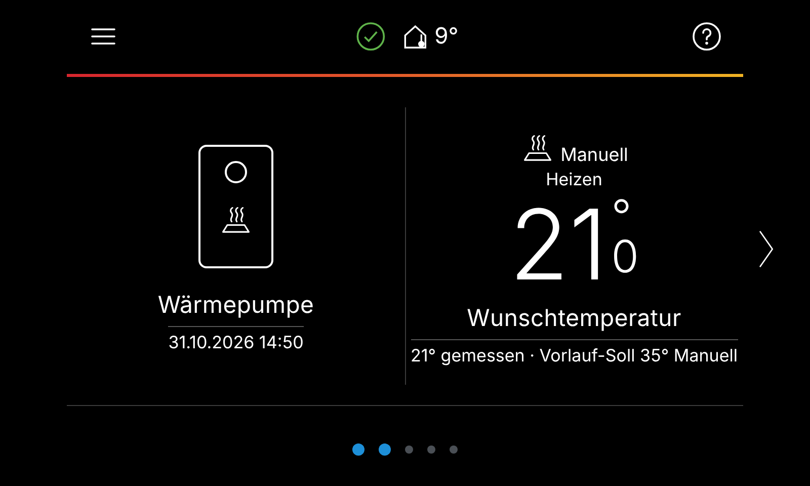 | 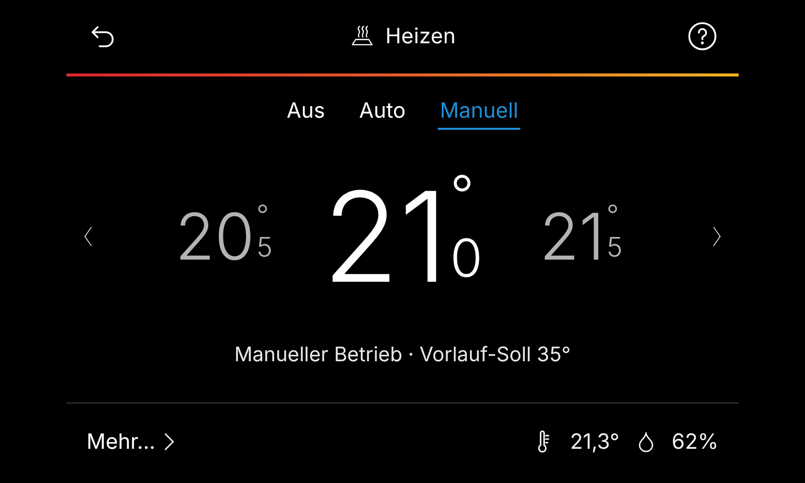 |
| **Warmwasser** | **Systemübersicht** |
| 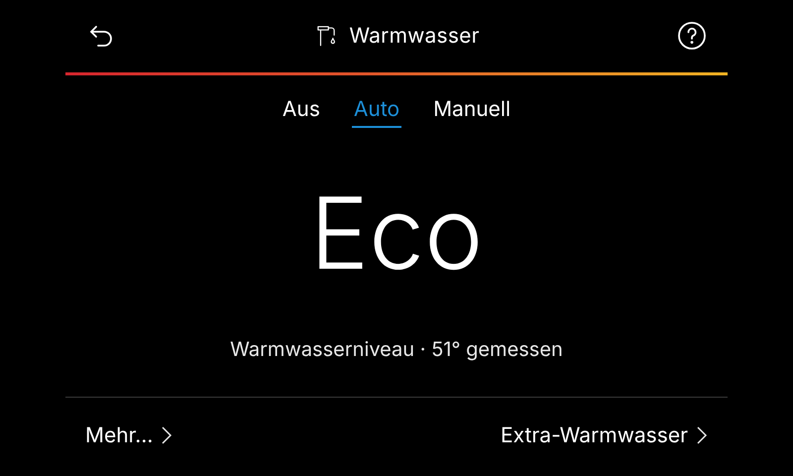 | 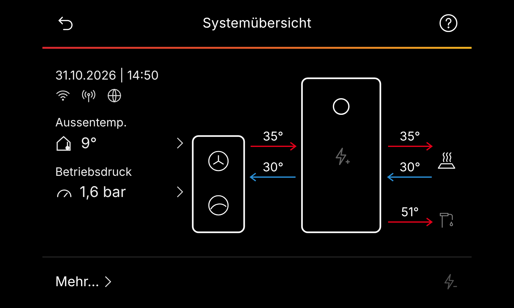 |
| **Energie Monitoring** | **Programmzeiten Warmwasser** |
| 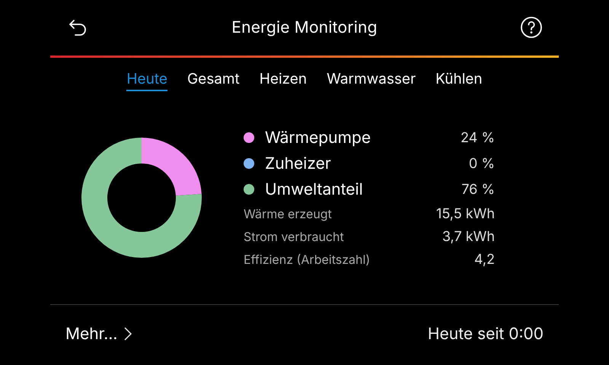 | 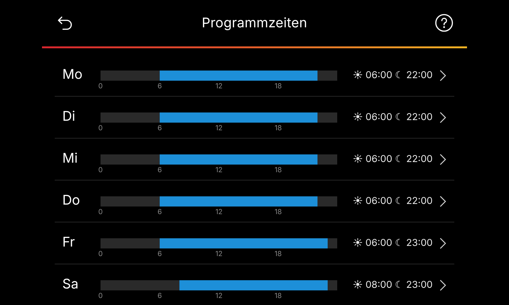 |
| **Heizkurve** | **Übersicht Kältekreislauf** |
| 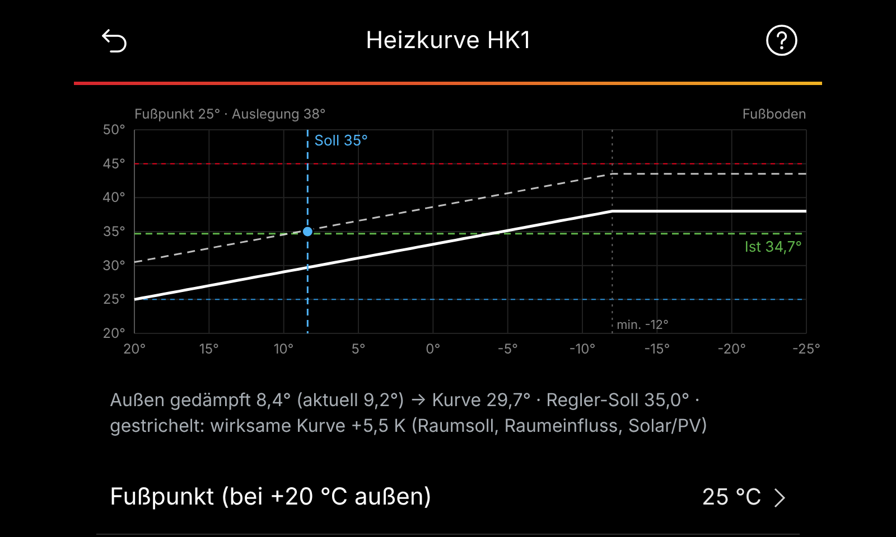 | 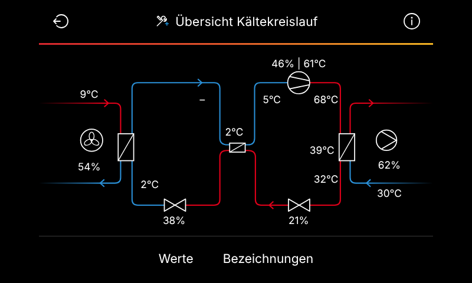 |

### Manager-Dashboard in Home Assistant

| System & Firmware | Bus-Log |
|:---:|:---:|
| 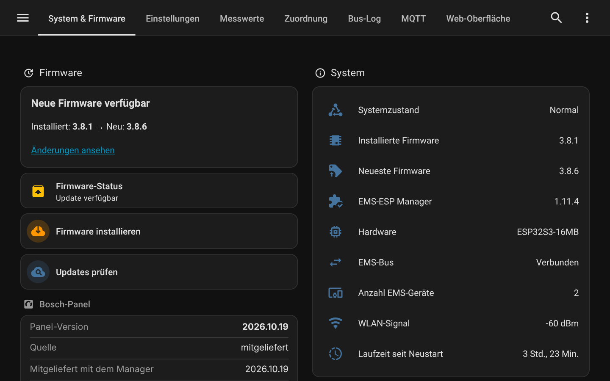 | 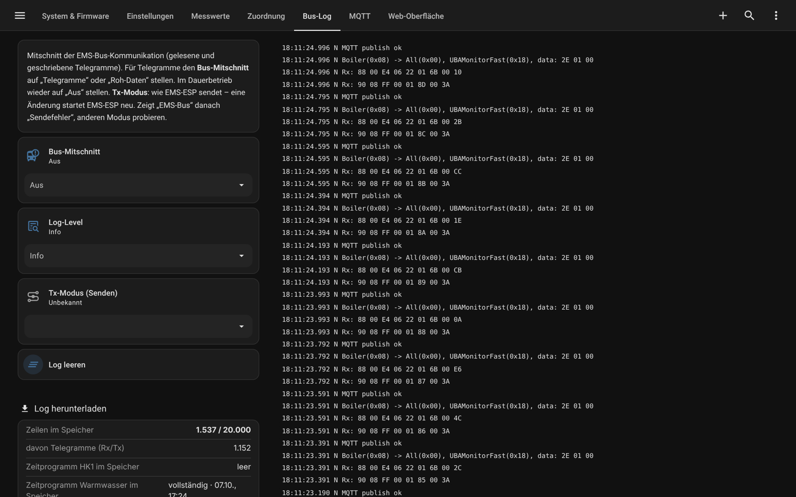 |
| **MQTT-Einstellungen** | **Entitäten-Zuordnung** |
| 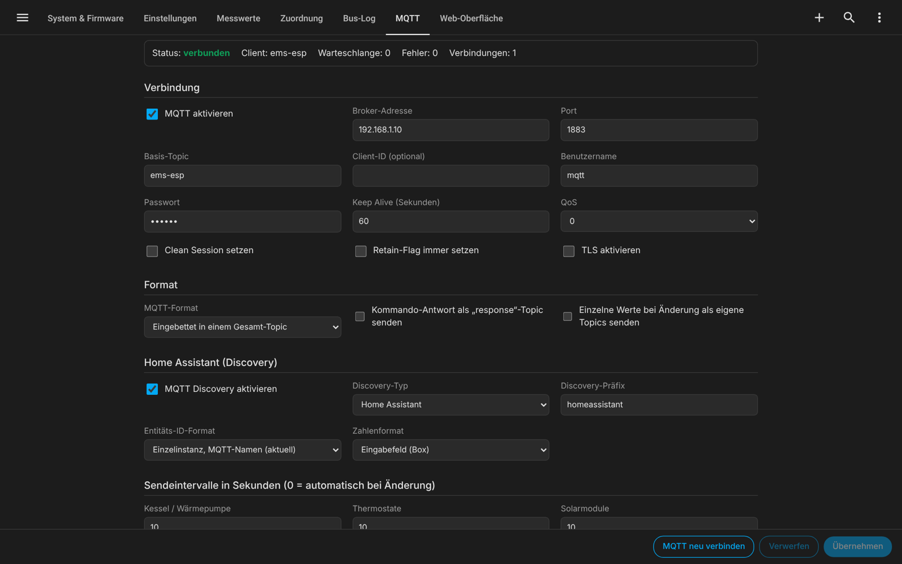 | 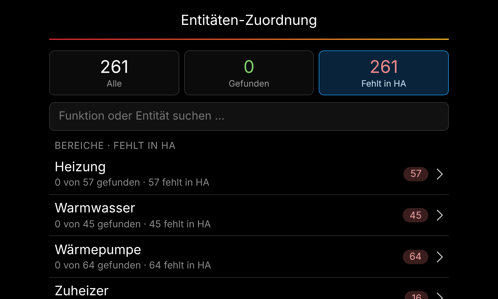 |

<sub>Screenshots mit Demo-Daten; einzelne Bilder zeigen ältere Versionen.</sub>

---

## Voraussetzungen

| | |
|---|---|
| **Home Assistant** | 2025.2 oder neuer (eigenes Integrations-Logo ab 2026.3) |
| **EMS-ESP** | 3.7 oder neuer (getestet mit 3.8.x), Zugang mit Admin-Benutzer |
| **Samsung EHS** | statt EMS-ESP: HACS-Integration **EHS Sentinel** mit RS485-Adapter (Steuermodus für Einstellungen) |
| **MQTT** | MQTT-Integration in Home Assistant, EMS-ESP mit aktivierter HA-Discovery |
| **Verlauf** | Recorder aktiv (Standard) – für Tageswerte und Warmwasser-Verlauf |

---

## Installation

### Über HACS (empfohlen)

1. HACS → ⋮ → **Benutzerdefinierte Repositories** → `https://github.com/Sascha883/EMS-ESP-Manager`, Typ **Integration**.
2. „EMS-ESP Manager“ installieren.
3. Home Assistant neu starten.

### Manuell

1. Die ZIP-Datei aus den [Releases](https://github.com/Sascha883/EMS-ESP-Manager/releases) herunterladen und entpacken.
2. Den Ordner `ems_esp_manager` nach `config/custom_components/` kopieren.
3. Home Assistant neu starten.

### Update

Über HACS aktualisieren (oder den Ordner ersetzen), Home Assistant neu starten und das Panel einmal neu laden (Strg+F5). Zuordnung, Heizkreis-Namen, Kiosk-Schlüssel, Programmzeiten und die Einstellungen der EMS-Regelung bleiben erhalten.

---

## Einrichtung

1. **Einstellungen → Geräte & Dienste → Integration hinzufügen → „EMS-ESP Manager“** und den Hersteller wählen: **Bosch / Buderus (EMS-ESP)** oder **Samsung EHS (EHS Sentinel)**. Das EMS-ESP wird per Zeroconf meist automatisch gefunden.
2. Bosch: **Adresse** des EMS-ESP (IP oder `ems-esp.local`), **Benutzer** und **Passwort** eines EMS-ESP-Admins eingeben. Samsung: nur bestätigen – die Werte kommen aus EHS Sentinel.
3. Unter **Konfigurieren** einstellen:
   - Seitenleisten-Einträge für das Dashboard und das Panel (für alle oder nur Admins).
   - Langlebiger Zugriffstoken für den **Kiosk-Zugriff** auf das Panel (z. B. Wand-Tablet ohne Anmeldung) – siehe [Zugriff von außen](#zugriff-von-außen-wand-tablet--kiosk).
   - **Fachbetrieb** (Name, Adresse, Telefon) für die Info-Seite des Panels.

Danach erscheinen in der Seitenleiste **„EMS-ESP“** (Dashboard) und **„Bosch EHS“** (Panel) – bei Samsung nur **„Samsung EHS“**. Bestehende Installationen gelten nach dem Update automatisch als Bosch.

### Zugriff von außen (Wand-Tablet / Kiosk)

Für ein Tablet ohne HA-Anmeldung (z. B. Safari an der Wand) braucht das Panel einen **langlebigen Zugriffstoken aus Home Assistant**. Die Integration legt diesen Token nicht selbst an – er ist deine Freigabe, dass das Panel auf HA zugreifen darf.

1. In HA unten links auf das **Profil** → Reiter **Sicherheit** → **Langlebige Zugriffstoken** → **Token erstellen** (Name z. B. „Bosch-Panel“).
2. Den angezeigten **langen Text** kopieren (beginnt mit `eyJ…`, wird nur einmal angezeigt) – nicht den Namen.
3. **Einstellungen → Geräte & Dienste → EMS-ESP Manager → Konfigurieren** → Feld **„Langlebiger Zugriffstoken aus HA“** einfügen → **Absenden**. Der Token wird beim Speichern geprüft; ein ungültiger Token wird mit Hinweis abgelehnt.
4. **Konfigurieren** erneut öffnen und die **Kiosk-Adresse** kopieren.
5. Die Adresse auf dem Tablet öffnen. Im Panel unter **Einstellungen → Internet** sollte „Verbunden (ws)“ stehen.

> **Wichtig:** „Neuen Kiosk-Schlüssel erzeugen“ erstellt **keinen** Token, sondern nur einen neuen geheimen Teil der Kiosk-Adresse (`?key=…`). Die Kiosk-Adresse verwendet immer den Token aus **Konfigurieren**; ist dieser ungültig, versucht das Panel zusätzlich den Token aus seinen eigenen Einstellungen. Die Kiosk-Adresse nur auf eigenen Geräten verwenden.

**Fehler „WebSocket: Token ungültig“ / Status „Demo“:** Home Assistant ist erreichbar, lehnt den Token aber ab → Schritte 1–4 mit einem neuen Token wiederholen. Test im Netzwerk: `curl -H "Authorization: Bearer DEIN_TOKEN" http://homeassistant.local:8123/api/` muss `{"message":"API running."}` liefern.

---

## Entitäts-Namen und EMS-ESP-Versionen

Das Panel findet die passenden Entitäten automatisch – egal, welches **Entity-ID-Format** im EMS-ESP eingestellt ist:

| Format im EMS-ESP | Beispiel |
|---|---|
| Einzelinstanz, MQTT-Namen (Standard) | `sensor.thermostat_hc1_summermode` |
| Mehrfachinstanzen | `sensor.ems_esp_thermostat_hc1_summermode` |
| Langnamen (v3.4) | `sensor.thermostat_hc1_summer_mode` |
| v3.5 / 3.6-kompatibel (Warmwasser) | `sensor.boiler_wwcurtemp` |
| In HA umbenannt / nach Gerät benannt | `sensor.warmepumpe_summer_mode` |

Beim **UI 800** liefert EMS-ESP 3.8.x einige Werte (Sommer-/Winterumschaltung, Heizbetrieb bis, Kühlstart, Verzögerungen) nur für die ganze Anlage statt pro Heizkreis – das Panel nutzt dann automatisch diese Werte. Auch die geänderte Betriebsart aus EMS-ESP 3.9-dev (Sommer/Auto/Winter) wird unterstützt.

Eigene Zuordnungen im Reiter **„Zuordnung“** haben immer Vorrang.

---

## Hinweise aus der Praxis (Bosch CS5800i / UI 800)

- **Tx-Modus nicht auf „Auto“ lassen.** Ab EMS-ESP 3.8.2 ist „Auto“ Standard; bei der CS5800i wählte die Automatik nach einem Neustart teils falsch (Bus-Status „Sendefehler“, Regler nicht erkannt). Fest **EMS+** (oder EMS) funktioniert.
- **Warmwasser Start-/Stopptemperatur:** Die Wärmepumpe erzwingt Stopp ≥ Start + 6 K (Komfort) bzw. + 7 K (Eco, Eco+) und hebt zu kleine Werte ohne Meldung an. Beim Absenken zuerst die Start-, dann die Stopptemperatur ändern.
- Die „Temp.-diff. für Beladung“ (`comfdiff` / `ecodiff` / `ecoplusdiff`) ist das Ladedelta (Vorlauf über Warmwassertemperatur), nicht der Abstand zwischen Start und Stopp.
- **Programmzeiten:** Der Regler beantwortet Leseanfragen nur in seinen 24-Byte-Blöcken; geschrieben wird immer das komplette Wochenprogramm – genau wie es das Display macht.
- **Aktuelles Niveau (Heizen/Absenken):** EMS-ESP meldet es beim UI 800 teils falsch. Das Panel ermittelt es deshalb aus den gelesenen Programmzeiten.
- **Uhrzeit:** Hat das Gateway keinen Internetzugang, läuft die EMS-ESP-Uhr weg. Im Reiter „Uhrzeit“ lässt sie sich von Home Assistant übernehmen.

---

## Fehler melden

Bitte ein [Issue](https://github.com/Sascha883/EMS-ESP-Manager/issues) anlegen mit:

- Version des EMS-ESP Managers und von EMS-ESP.
- Regler / Wärmepumpe (z. B. UI 800, CS5800i).
- Screenshot der betroffenen Seite.
- Bei fehlenden Werten: Ausgabe dieser Vorlage (Entwicklerwerkzeuge → Template):
  ```
  {{ integration_entities('mqtt') | select('search', 'thermostat|boiler') | list }}
  ```
- Bei Bus-Themen: Download aus dem Reiter **Bus-Log** (enthält Manager-Version und Geräteliste).

---

## Lizenz

**PolyForm Noncommercial License 1.0.0** – siehe [LICENSE](LICENSE).

- ✅ Erlaubt: private Nutzung, Ausprobieren, Anpassen für den Eigenbedarf, gemeinnützige Organisationen, Bildung, Forschung.
- ❌ Nicht erlaubt: kommerzielle Nutzung jeder Art – z. B. Einsatz bei Kunden durch Fachbetriebe oder Dienstleister, Verkauf oder Einbau in kommerzielle Produkte.

Kommerzielle Nutzung nur mit gesonderter Lizenz – Anfrage über [haustechnik-matheis.de](https://haustechnik-matheis.de).

Die Nutzung erfolgt auf eigene Gefahr und ohne jegliche Gewährleistung oder Haftung. Versionen, die vor dem Lizenzwechsel unter MIT veröffentlicht wurden, bleiben unter MIT.

---

<p align="center">
  <picture>
    <source media="(prefers-color-scheme: dark)" srcset="docs/images/logo-dark.png">
    
  </picture><br>
  <b>Sascha Matheis Haustechnik</b> · Espenau · Kassel · Nordhessen<br>
  <a href="https://haustechnik-matheis.de">haustechnik-matheis.de</a> · Instagram <a href="https://www.instagram.com/haustechnik_matheis">@haustechnik_matheis</a>
</p>
